# FitApp

An open-source, watch-centred health website built for **Zepp / Amazfit** watches. FitApp brings the activity, sleep and heart-rate data recorded by a watch together with the things a watch can't measure (mood, meals, water, periods and symptoms) and explains what the combined records show, with every calculation visible.

- **Watch first.** A dashboard overview (today's goals as donuts, a month calendar, your journal and a widget per measurement), Activity (steps, distance, active energy, workouts), Sleep (duration, schedule, stages), Heart rate (latest reading, daily readings, resting trend), Stress (watch estimate, 0–100 with zones), Blood oxygen (overnight SpO₂), Skin temperature (nightly deviation from baseline) and a Watch & sync page with device, capabilities and freshness.
- **Personal trackers.** A step-by-step quick log (one question per step, with picture cards) for mood check-ins (mood, energy, emotions, self-reported stress, notes), meals, water and an optional cycle tracker. Meal nutrients are estimated from a built-in food list from the food, amount and unit you pick, or typed in yourself; estimates are labelled as such.
- **Explainable wellbeing overview.** Rule-based observations with their calculation, period, counts and links to the records, and explicit "not enough data" states. No AI service, scores, diagnoses or predictions.
- **Zepp, ready to connect.** The backend includes a full Zepp Open Platform integration (OAuth, webhooks, FIT workouts, heart-rate pulls, backfill). Add your Zepp credentials to `.env`, register two URLs with Zepp and press **Connect Zepp account**. See [docs/zepp.md](docs/zepp.md).
- **Works without hardware.** A complete simulated-watch demo with six months of history runs entirely in the browser. Any other provider or bridge can feed the backend through the documented ingestion API.

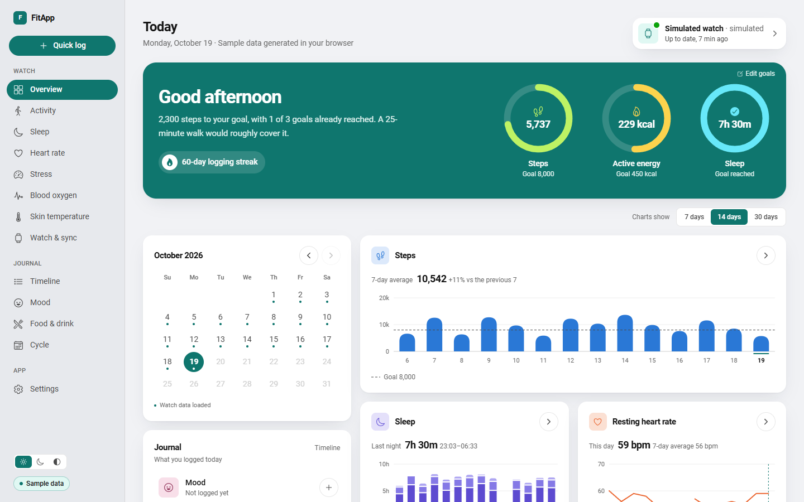

| | | |
| --- | --- | --- |
| 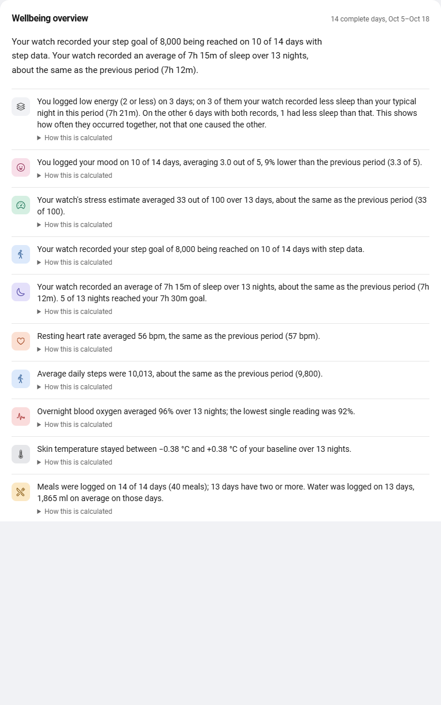 | 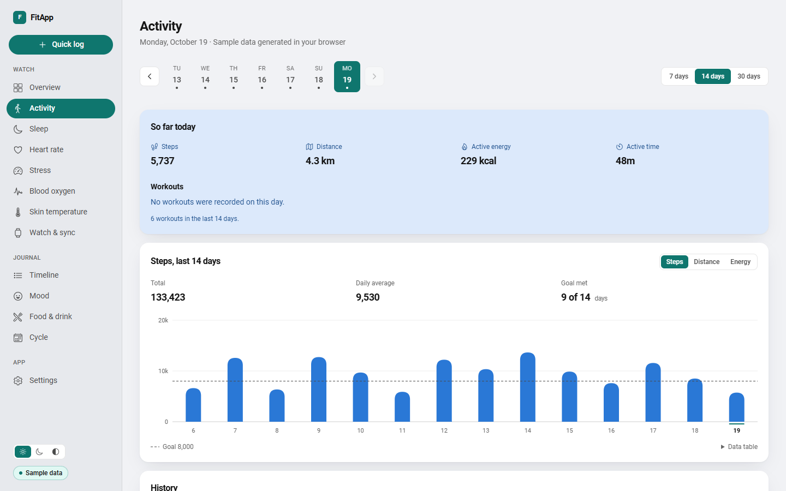 | 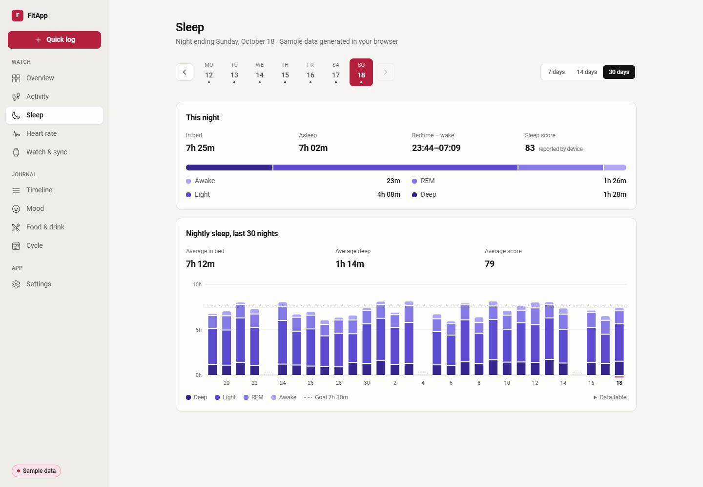 |
| 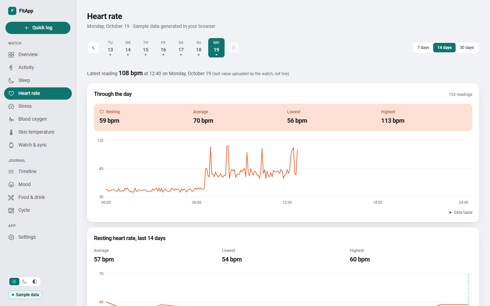 | 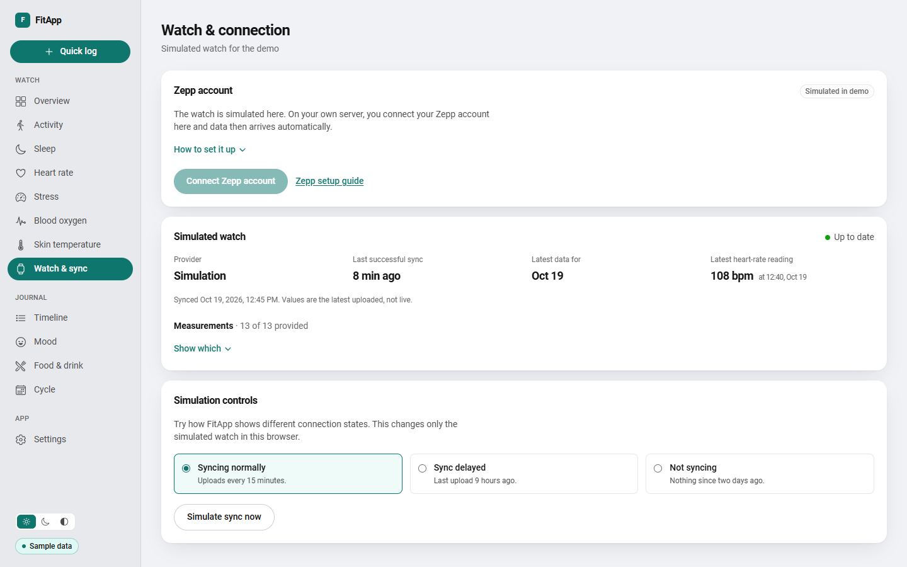 | 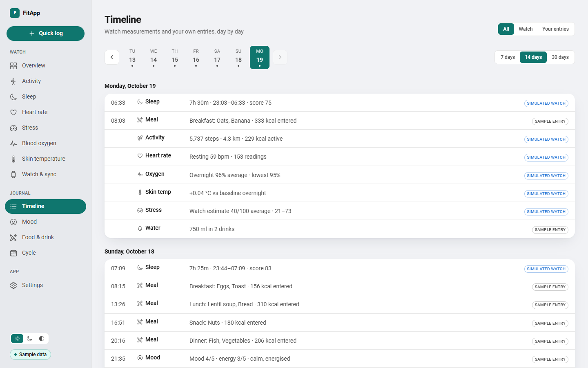 |
| 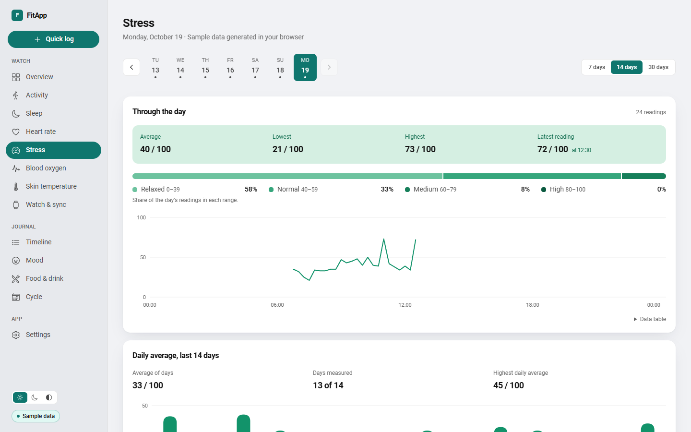 | 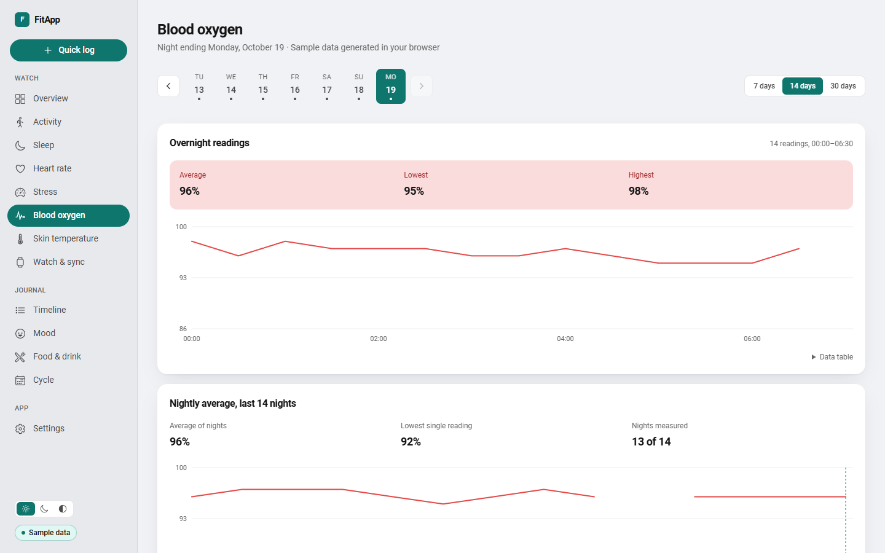 | 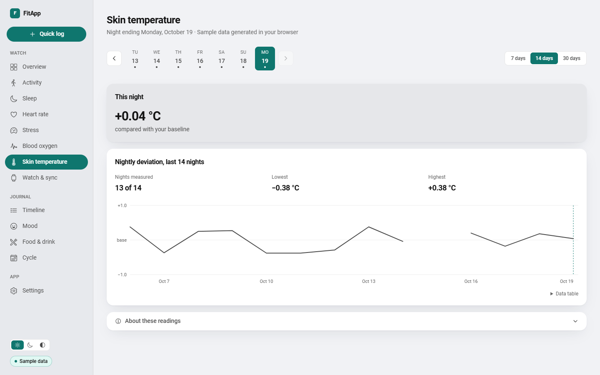 |
| 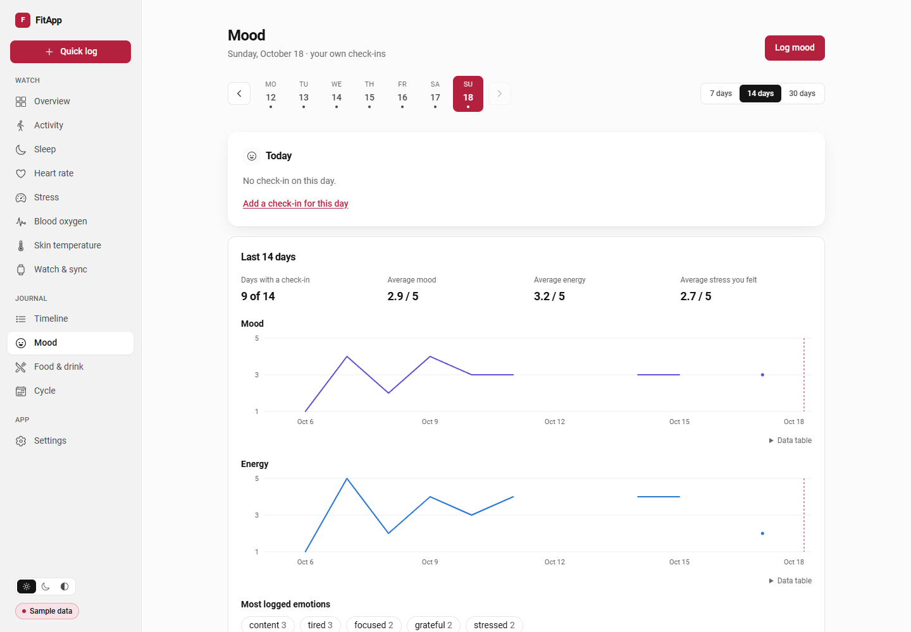 | 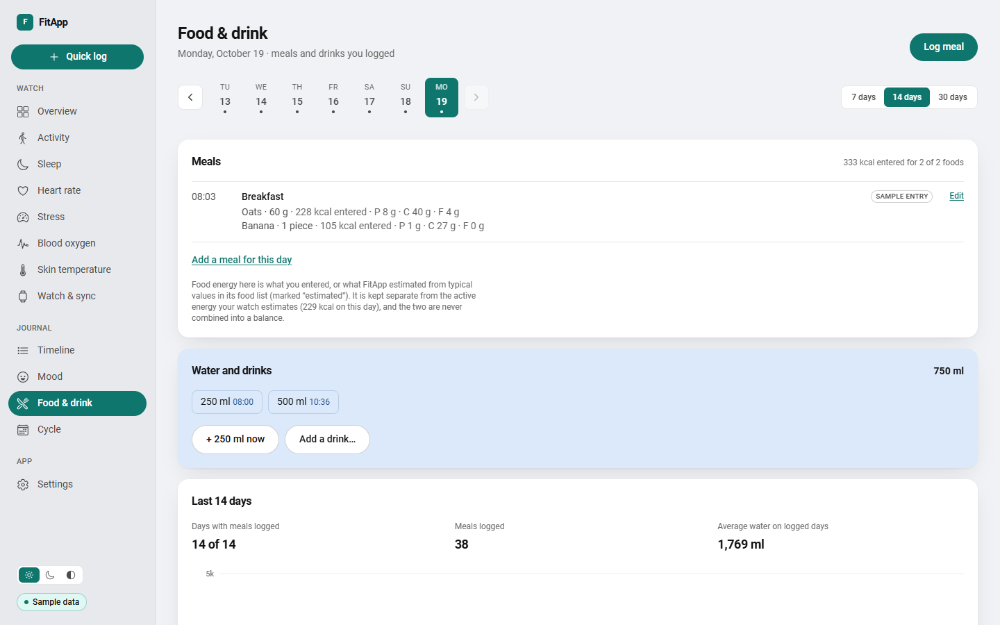 | 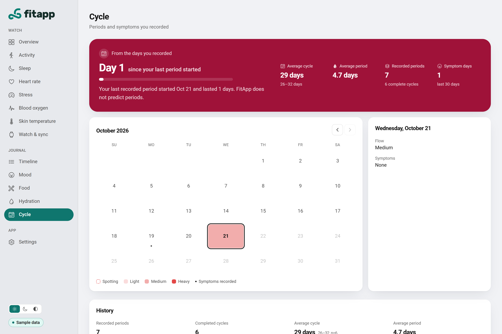 |

<p>
  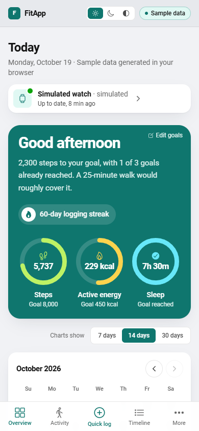
  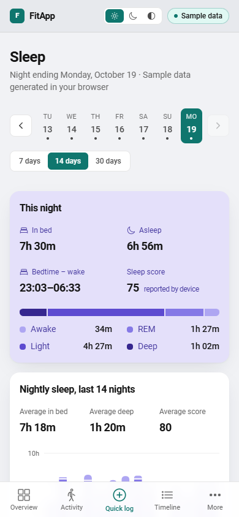
  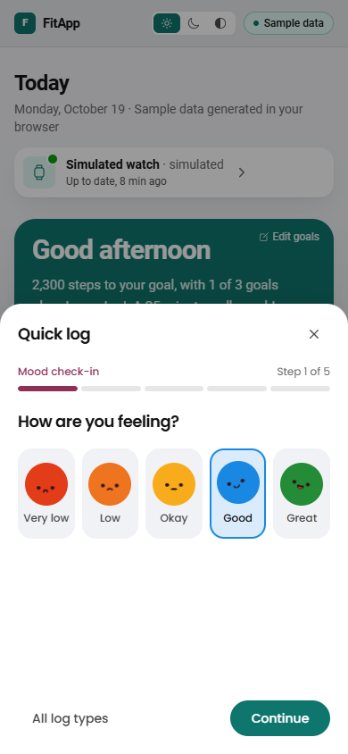
</p>

Screenshots are from the demo. All values in them are simulated.

## What works and what is tested

| Area | Status |
| --- | --- |
| Demo mode (simulated watch, journal fixtures, local edits, Reset demo) | Works offline in the browser; unit-tested and checked in Chromium at phone and desktop sizes |
| FitApp backend: auth, fitness read API, journal CRUD, ingestion | Implemented; feature tests; checked end to end against a local server with `curl` and the website |
| Ingestion of a third-party source | Contract implemented and tested with representative payloads (`docs/examples/ingest-sample.json` and a 30-day generated payload) |
| Zepp integration (OAuth, webhooks, FIT workouts, heart-rate pull, backfill, disconnect) | **Implemented to Zepp's published docs.** Tested with faked Zepp responses and Zepp-shaped webhooks posted to a local server. **Not verified against a live Zepp account** (no partner credentials available) |
| A real watch | **Not tested.** No physical device was used |

## Repository layout

```
frontend-fitapp/   Vue 3 + TypeScript + Ionic + Tailwind 4 + Pinia website
  src/views/       screens            src/components/  presentation, charts, forms
  src/stores/      shared state       src/composables/ reusable behaviour
  src/api/         HTTP + payload normalisation
  src/data/        demo generators, adapters, derivations (cycle, journal)
  src/insights/    wellbeing rules     src/types/       data contracts
backend-fitapp/    Laravel 12 + Sanctum API (thin controllers, form requests, services, resources)
docs/openapi.yaml  API contract        docs/integration.md  connecting a data source
```

## Run the demo (no backend)

Requires Node 20+.

```bash
cd frontend-fitapp
npm ci
npm run dev
```

Open the printed URL (Vite's default is http://localhost:5173). Without `VITE_BACKEND_URI` the site runs in demo mode: no login and no network calls. Demo changes (entries, goals, tracker choices, simulated connection state) are kept in this browser's `localStorage` until **Settings → Reset demo**.

## Run the full stack

Requires PHP 8.2+ with SQLite, Composer, and Node 20+.

**Backend**

```bash
cd backend-fitapp
composer install
cp .env.example .env
php artisan key:generate
touch database/database.sqlite
php artisan migrate
php artisan fitapp:create-user you@example.com --name="Your name"   # prompts for a password
php artisan serve                                                     # http://localhost:8000
```

`FRONTEND_ORIGINS` in `.env` lists the website origins allowed by CORS (default `http://localhost:8100,http://localhost:5173`).

**Frontend**

```bash
cd frontend-fitapp
cp .env.example .env
# set VITE_BACKEND_URI=http://localhost:8000
npm ci
npm run dev
```

Sign in with the account you created. Settings lets you switch between the demo and your backend.

**Send some data**

```bash
cd backend-fitapp
TOKEN=$(php artisan fitapp:ingest-token you@example.com --name=try | tail -1)
curl -X POST http://localhost:8000/api/ingest \
  -H "Authorization: Bearer $TOKEN" -H "Content-Type: application/json" -H "Accept: application/json" \
  --data @../docs/examples/ingest-sample.json
```

For realistic data, generate payloads from the demo generator (in `frontend-fitapp`) and post each one: `npx vite-node scripts/demo-payload.ts 30 0 > /tmp/demo.json` gives the last 30 days; `30 30`, `30 60`, … go further back (one request holds about 30 days). It is labelled as FitApp sample data.

## Connect your Zepp watch

Short version (full guide: **[docs/zepp.md](docs/zepp.md)**):

1. Get partner access on the [Zepp Open Platform](https://devopen.zepp.com/docs/getting-started/introduction) and a client ID and secret.
2. Fill the placeholders in `backend-fitapp/.env`: `ZEPP_CLIENT_ID`, `ZEPP_CLIENT_SECRET`, `ZEPP_REDIRECT_URI`, `ZEPP_WEBHOOK_TOKEN` (and `APP_URL`, `FRONTEND_URL`).
3. Deploy the backend on public HTTPS, run `php artisan migrate --force`, a queue worker (`php artisan queue:work`) and the scheduler (`php artisan schedule:run` every minute).
4. Register `…/api/zepp/callback` and `…/api/zepp/webhook/<ZEPP_WEBHOOK_TOKEN>` in the Zepp Developer Console.
5. In FitApp open **Watch & sync → Connect Zepp account**.

Until the credentials are set, Watch & sync shows Zepp as "Not configured" and lists exactly what is missing.

## API

- Contract: [`docs/openapi.yaml`](docs/openapi.yaml) (OpenAPI 3.1). Open it in any OpenAPI viewer.
- Website endpoints use a token from `POST /api/login` (`app` ability): `/api/user`, `/api/fitness/days`, `/api/fitness/heart-rate/{date}`, `/api/fitness/status`, `/api/journal/{mood,meals,hydration,cycle-days}`, `/api/ingest-tokens`.
- Sources use an ingest-only token: `POST /api/ingest`.
- Zepp: `/api/zepp/{status,authorize,connection,backfill}` for the signed-in user, plus the public `GET /api/zepp/callback` (OAuth) and `POST /api/zepp/webhook/{token}` (events).
- Units: metres, kilocalories (active energy only), minutes, bpm, millilitres. Local calendar dates are `YYYY-MM-DD`; instants carry an offset, are stored in UTC and returned in the user's timezone. Missing values are `null`.
- Journal edits may send the `updated_at` they last saw; if the record changed since, the API answers `409` instead of overwriting it. Notes are encrypted at rest.

How to connect another provider or bridge, including field mapping: **[docs/integration.md](docs/integration.md)**.

## Tests

```bash
cd backend-fitapp && php artisan test          # auth, ownership, ingestion, journal, dates, Zepp (faked)
cd frontend-fitapp && npx vitest run            # demo data, adapters, cycle, insights, food list, components
cd frontend-fitapp && npm run build             # type-check (vue-tsc) and production build
```

GitHub Actions runs all three on every push and pull request (`.github/workflows/ci.yml`).

## Host the demo for free

The demo is a static site; build it without `VITE_BACKEND_URI`.

- **GitHub Pages:** enable *Settings → Pages → Source: GitHub Actions*, then run the **Deploy demo to GitHub Pages** workflow. It builds with `VITE_BASE=/<repository>/` and adds a `404.html` fallback for deep links.
- **Netlify or Cloudflare Pages:** base directory `frontend-fitapp`, build command `npm ci && npm run build`, output directory `dist`. `public/_redirects` already provides the single-page-app fallback.

## Self-host the backend

Any host with PHP 8.2+ works (a small VPS, or a PaaS that runs Laravel). In production:

1. Set `APP_ENV=production`, `APP_DEBUG=false`, a generated `APP_KEY` (keep it: it also encrypts notes), `APP_URL`, and `FRONTEND_ORIGINS` to your website's origin.
2. Use SQLite or point `DB_*` to MySQL/PostgreSQL, then run `php artisan migrate --force`.
3. Serve `backend-fitapp/public` over HTTPS behind Nginx/Apache (or `php artisan serve` only for testing).
4. Build the website with `VITE_BACKEND_URI=https://your-api.example` and host `frontend-fitapp/dist` anywhere static.
5. Create accounts with `php artisan fitapp:create-user`. There is no public sign-up.
6. For Zepp: run a queue worker and the scheduler (cron `* * * * * php artisan schedule:run`), then follow [docs/zepp.md](docs/zepp.md).

Provider credentials (Zepp client secret, tokens) stay on the server; the website never sees them.

## Limitations

- No real watch or Zepp partner credentials were available. The Zepp integration follows Zepp's published documentation and is tested with faked responses; the first live connection still needs checking (see [docs/zepp.md](docs/zepp.md#checking-the-first-connection)).
- Zepp heart-rate readings use Zepp's transitional pull API. Zepp delivers SpO₂ and skin temperature, but its Open Platform offers no watch-measured stress, so Zepp accounts show no stress data. HRV, body composition and nutrition events are received but not stored.
- Stress, SpO₂ and skin temperature are shown as recorded; FitApp does not flag or interpret them medically.
- The ingestion contract carries steps, distance, active energy and minutes, workouts, sleep (with stages and score), resting heart rate, heart-rate readings, watch-estimated stress, SpO₂ readings and nightly skin-temperature deviation. HRV is not part of it yet.
- Food nutrients come from a built-in list of about 60 common foods with typical values per 100 g (rounded from USDA FoodData Central). They are estimates: real food varies by recipe, brand and portion. Foods outside the list have only the values the user types.
- The wellbeing overview describes co-occurrence in the user's own records. It is not medical advice, and the cycle tracker makes no predictions.
- Single-user accounts created on the server; no password reset or self-service sign-up.

## Credits

- Animated mood faces: ["Simple animating emotions"](https://codepen.io/MishaHahaha/pen/grzLJy) by Misha Heesakkers (MIT, as a public CodePen pen); the "Low" face is drawn in the same style.
- Typical food values: rounded from [USDA FoodData Central](https://fdc.nal.usda.gov/) (public domain).
- Icons: [Ionicons](https://ionic.io/ionicons) (MIT).

## License

[MIT](LICENSE)
